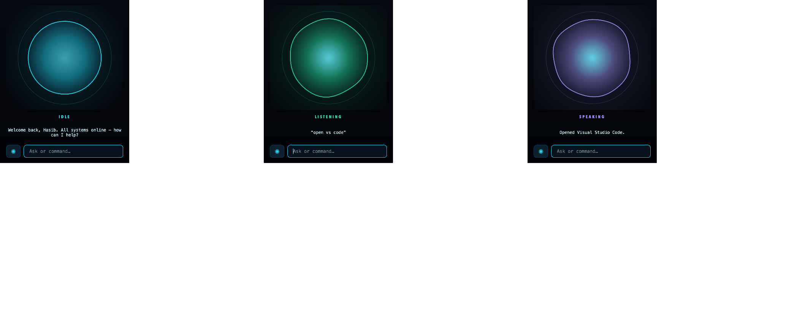

# JARVIS — HUD interface + clap listener

Two programs that work together:

| | What it is | Run it with |
| --- | --- | --- |
| **`main.py`** | A futuristic **JARVIS-style HUD**: animated AI core, live system telemetry, voice input, AI responses and an activity log. | `python main.py` |
| **`jarvis.py`** | A background **double-clap listener** that opens the HUD (and your editor) when you clap twice. | `python jarvis.py` |

You can run the HUD on its own — the clap listener is only the hands-free launcher.

## Setup

```bash
python -m pip install -r requirements.txt
cp .env.example .env      # then fill in your keys (optional)
```

Everything except `PySide6` degrades gracefully: if the optional local Llama runtime or model is missing,
WEBSTER uses its built-in offline engine. No microphone disables voice input; no `psutil` hides the telemetry gauges.

---

# 1. The HUD (`main.py`)

```bash
python main.py
```

It opens as a **small orb window**, parked near the bottom-right of the screen.



**Layout** — an animated circle, the current state, the last thing said, and a
microphone button with a text box. Nothing else: no telemetry, no log. The system
monitor still runs in the background, so spoken commands like `status` keep working —
it simply has nothing on screen.

**Why it is small.** Repainting a fullscreen window costs ~24 ms a frame on a retina
display and intermittently stalls audio playback, which is heard as a distorted voice.
The orb costs ~3.8 ms, so the problem disappears rather than being traded off against
frame rate — measured at **zero audio underruns** with the orb animating at 30 fps.

**The orb** is a circle whose edge ripples with the audio level and whose colour tracks
the assistant state. The motion is deliberately subtle — a circle that breathes, not a
blob. The level driving it is your **measured** microphone amplitude while listening,
and the measured waveform of the reply while speaking.

Click the orb (or press **Space**) to talk, **Enter** to focus the text box, **Ctrl+Q**
to quit. `JARVIS_MINI_ON_TOP=true` keeps it above other windows.

<details>
<summary>The old fullscreen HUD is still available</summary>

`JARVIS_UI_MODE=hud` brings back the full dashboard — telemetry gauges, activity log,
audio spectrum and the rotating 3D wireframe sphere. It looks better in a screenshot,
but it is the configuration that interferes with audio, so lower `JARVIS_TARGET_FPS`
(around 8–16) if you use it.
</details>

**Assistant states** drive the core's colour, speed and the spectrum:

| State | Meaning | Colour |
| --- | --- | --- |
| `IDLE` | Waiting for input | cyan |
| `LISTENING` | Recording from the microphone | green |
| `PROCESSING` | Running a command or querying the AI | amber |
| `SPEAKING` | Reading the reply aloud | violet |
| `ERROR` | Last operation failed (transient — returns to `IDLE`) | red |

## Commands

Type in the bar or speak them. These run locally — they never reach the AI:

`status` · `cpu` · `memory` · `disk` · `battery` · `network` · `time` · `date` ·
`uptime` · `sysinfo` · `engine` · `open <app or https URL>` · `sleep display` ·
`clear` · `quit` · `help`

`quit` (also `exit`, `shutdown`, `close`, `goodbye`) plays a power-down sequence — the
sphere spins up, collapses to nothing and goes red, the spectrum flattens, and the header
reads POWERING DOWN — then closes once the farewell has finished, with a 6-second
backstop so a wedged voice can never strand you. **Ctrl+Q** closes without speaking.

`open` matches app names the way people actually say them. Spacing, case and punctuation
are ignored, so **VS Code**, `vs code`, `VSCode`, `vs-code` and `visual studio code` are
all the same entry; the verb is matched anywhere in the sentence and `launch` / `start` /
`run` / `pull up` / `fire up` work too. So `jarvis open vs code`, `can you open chrome`
and `i want to open spotify` are all handled locally. 21 apps are allow-listed; anything
else is refused by name.

Recognised built-in commands and reviewed action intents run locally. Other free-form questions are sent to the selected AI engine; in the default offline mode WEBSTER explains that general AI reasoning is not connected.

**Safety.** AI-generated text can never execute anything. Every action is a named Python
handler behind an explicit pattern match, subprocesses are launched with argument lists
(never a shell), and `open` only accepts an allow-listed app or an `https` URL. Actions
with a visible side effect ask first and run only after you reply `yes`.

## Voice

Press **MICROPHONE** to record one utterance; it stops automatically on silence.
Pressing it **while JARVIS is talking cuts the reply off and starts listening immediately**
— no need to wait for it to finish.
Capture uses `sounddevice` (PortAudio) — **PyAudio is not required**. Transcription uses
Google's recogniser via `SpeechRecognition`, which needs a network connection.
Replies are spoken with the system voice (`say` on macOS, SAPI on Windows, `espeak` on
Linux), or with ElevenLabs if you configure a key.

## AI engine

`AIEngine` in `assistant/ai_engine.py` is the seam — the UI continues to use
the same `process()` interface regardless of which local backend is active.

- **`LlamaCppEngine` — default.** Runs Llama 3.2 3B Instruct from a local GGUF
  file using `llama-cpp-python`. Inference is on-device; Ollama is not required.
- **`OfflineEngine` — automatic fallback.** Used if the optional Python runtime
  or model file is missing, or if local model loading fails. It requires no API,
  internet connection, Ollama server, or model download.
- Gemini, OpenAI, Claude and Ollama adapters remain optional legacy integrations,
  but the default `llama` provider never falls back to any of them.

### Set up local Llama 3.2 3B

1. Install the optional runtime in the active virtual environment:

   ```powershell
   python -m pip install -r requirements-local.txt
   ```

2. Obtain a Llama 3.2 3B Instruct **GGUF** model file (Q4_K_M quantization is
   the recommended starting point for this machine) and place it at:

   ```text
   models/Llama-3.2-3B-Instruct-Q4_K_M.gguf
   ```

   Create the `models` folder if it does not exist. WEBSTER does not download
   model weights automatically.

3. In `.env`, select the local provider and model path:

   ```env
   JARVIS_AI_PROVIDER=llama
   WEBSTER_LLAMA_MODEL=models/Llama-3.2-3B-Instruct-Q4_K_M.gguf
   WEBSTER_LLAMA_CONTEXT=4096
   WEBSTER_LLAMA_THREADS=3
   ```

If the runtime or model is unavailable, WEBSTER selects `OfflineEngine` and
continues working locally. It does not attempt a cloud request or start Ollama.
The first load of a 3B model can take a little time; inference runs on the CPU
by default to keep compatibility with systems without a supported GPU backend.

The built-in offline engine still handles deterministic commands, Smriti/Gyaan
storage and reviewed local actions. It is a fallback, not a general-purpose LLM,
so free-form reasoning is more limited when Llama cannot load.

### Local action understanding

The action pipeline uses two stages:

1. The dependency-free `OfflineActionRouter` tries known phrases and argument
   patterns first.
2. If it abstains on an action-like request, `LlamaCppEngine.plan_action()` may
   classify the request against the discovered action IDs and descriptions. It
   returns constrained JSON (`action_id`, `arguments`, `confidence`) and must
   choose an ID already present in the catalog. It cannot return code or execute
   an action. Normal questions skip this planning step and go straight to chat.

`CommandRouter` validates the proposal, asks for missing required details, and
creates the normal action request. `Niyantrak` remains the final permission gate;
this integration does not bypass the existing confirmation flow. If Llama is
unavailable, the model planner abstains and the deterministic offline router
continues to work.

Offline action routing does not automatically load or download embedding models.
The optional semantic matcher is used only when explicitly injected with a local
model already prepared by the user. The GGUF model is also supplied manually;
WEBSTER does not fetch model files in the background.

### Using Ollama

> **A local Ollama does not use an API key.** It is an unauthenticated HTTP server on
> your own machine, so there is no key to create and none to paste. `OLLAMA_API_KEY`
> exists here only for Ollama's hosted service or a self-hosted instance behind an
> authenticating proxy; leave it blank for a normal local install.

```bash
ollama serve              # start the server (often already running)
ollama pull llama3.2:1b   # or any model you prefer
```

Then in `.env`:

```env
JARVIS_AI_PROVIDER=ollama
OLLAMA_MODEL=llama3.2:1b
```

That is the whole setup. Ollama serves an OpenAI-compatible API at `/v1`, so this reuses
the same request path and only swaps the endpoint — no extra dependency.

**Remote or hosted Ollama.** Point `OLLAMA_HOST` at the machine, and set
`OLLAMA_API_KEY` if it requires authentication (sent as the bearer token):

```env
JARVIS_AI_PROVIDER=ollama
OLLAMA_HOST=https://ollama.example.com
OLLAMA_API_KEY=your-token-here
```

`/v1` is appended automatically if you leave it off.

**When something is wrong it tells you what to run** rather than surfacing a raw HTTP
error — a stopped server gives *"Could not reach Ollama at … Start it with: ollama
serve"*, and a model you have not pulled gives *"Model 'x' is not pulled. Run: ollama
pull x"*.

If you see *"Model 'x' was not found for this key"* on OpenAI, set `OPENAI_MODEL` to a
model your account can use. The engine also copes with either output-token parameter
name, so both current chat models and reasoning models work without a config change.

## Configuration

Copy `.env.example` to `.env`. Every value is optional — the HUD starts without any of them.

| Variable | Purpose |
| --- | --- |
| `JARVIS_USER_NAME` | Who JARVIS greets (default `Hasib`). |
| `JARVIS_START_FULLSCREEN` | `false` starts windowed instead of fullscreen. |
| `OPENAI_API_KEY` | Enables the OpenAI engine. Starts with `sk-`. Without it the HUD runs offline. |
| `OPENAI_MODEL` | Model id (default `gpt-4o-mini`). |
| `JARVIS_AI_PROVIDER` | `offline` (default), `auto`, `gemini`, `openai`, `ollama`, or `claude`. |
| `OLLAMA_HOST` / `OLLAMA_MODEL` | Local or remote Ollama. **No API key needed locally.** |
| `OLLAMA_API_KEY` | Only for a hosted/proxied Ollama; blank for a local install. |
| `ANTHROPIC_API_KEY` / `ANTHROPIC_MODEL` | Optional Claude backend instead of OpenAI. |
| `JARVIS_SPEECH_ENABLED` | `false` disables the microphone entirely. |
| `JARVIS_TTS_ENABLED` | `false` mutes spoken replies (text still appears). |
| `JARVIS_INPUT_DEVICE` | Mic override: device index or a substring of its name. |
| `JARVIS_LISTEN_MAX_SECONDS` / `JARVIS_LISTEN_SILENCE_SECONDS` | Recording length and the silence gap that ends it. |
| `JARVIS_MONITOR_INTERVAL` | Seconds between telemetry samples (default `1.5`). |
| `JARVIS_TARGET_FPS` | Animation frame rate (default `20`). See the note below. |
| `ELEVENLABS_API_KEY` / `ELEVENLABS_VOICE_ID` | Optional ElevenLabs voice instead of the system voice. |

Colours, fonts and sphere density live in `config.py` (`THEME`, `SPHERE_POINTS`,
`MAX_CORE_RADIUS`).

### Painting, and why the voice used to distort

On a **fullscreen retina** display each painted frame costs ~24 ms, dominated by the
window flush at 3360×2100 — not by how much is drawn, so mesh density and core size
barely move it. Streaming the OS voice puts a hard real-time deadline on playback, and
that painting intermittently blew it: a stuttering, distorted voice, which went away as
soon as another window took focus and the HUD stopped repainting.

Throttling the frame rate only traded that off. The actual fix is in
`SpeechEngine._speak_rendered`: **render the speech to a file first, then play it through
an audio buffer** that absorbs the stalls. Rendering has no deadline, and playback is now
immune — measured at zero audio underruns with the HUD painting at full rate. It also
hands the core the real waveform, so the sphere reacts to measured amplitude rather than
a synthesised envelope.

So `JARVIS_TARGET_FPS` (24) now applies while speaking too. `JARVIS_AUDIO_FPS` (16) and
the spectrum throttle are left for the cases that *are* still live: recording from the
microphone, and platforms without the buffered playback path.

## Architecture

```text
main.py              entry point: QApplication, palette, window
config.py            theme, tunables, env/secret loading
ui/
  main_window.py     layout, styling, signal wiring, the single animation clock
  hud.py             animated AI core (rings, orbits, reactor)
  animations.py      easing, smoothing, oscillators
  widgets.py         glass panels, gauges, spectrum, log, input bar
assistant/
  assistant_manager.py  state machine + QThreadPool orchestration  ← the only UI seam
  ai_engine.py          AIEngine interface, Claude + offline backends
  speech.py             microphone capture, transcription, text-to-speech
  commands.py           allow-listed command routing and confirmations
system/
  system_monitor.py  psutil polling on a QThread → SystemStats signal
  system_info.py     static host facts and formatting
```

**Nothing slow runs on the GUI thread.** System polling lives on its own `QThread`;
recognition, AI calls and speech run on a `QThreadPool`; results return as Qt signals.
Animation is driven by one 30 fps timer that pauses when the window is hidden, so a slow
AI response never stutters the interface. Typing while JARVIS is busy queues the input
rather than dropping it.

---

# 2. The clap listener (`jarvis.py`)

```bash
python jarvis.py
```

Listens for a **double clap** and then opens the HUD and your editor.

| Step | Controlled by |
| ---- | ------------- |
| JARVIS HUD | `OPEN_JARVIS_HUD_ON_DOUBLE_CLAP` — launches `main.py` in its own process |
| Your editor | `FOCUS_EXISTING_VSCODE_ON_DOUBLE_CLAP` / `OPEN_NEW_VSCODE_ON_DOUBLE_CLAP` — **both off by default**, so only the HUD opens |
| Welcome speech | `JARVIS_WELCOME_ENABLED`, `JARVIS_WELCOME_PHRASE` |
| Chrome windows | `CHROME_TARGETS` — **empty by default**, so no browser opens. Add entries to open pages. |
| Spotify/YouTube track | `SONG_URI` — **empty by default**, set it to also open a track |

Works on **macOS** and **Windows**. Window placement across multiple monitors is supported
on both (CoreGraphics on macOS, the Win32 API on Windows); F11 fullscreen for VS Code is
Windows-only.

### Which editor opens

`EDITOR_CANDIDATES` lists editors in priority order — Visual Studio Code, then Cursor,
then Antigravity IDE. The **first one installed** is what a double clap opens; they are
all VS Code builds, so the same launch and focus logic works for each. The startup log
prints which one was found. Reorder the list to change the preference.

The flow runs **once per process** by default (`RUN_ONCE_PER_PROCESS = True`); later double
claps are detected and logged but do not re-open anything. Set it to `False` to fire every time.

## Environment variables (clap listener)

The script loads a **`.env` file** in the same folder as `jarvis.py` (via `python-dotenv`).
You can also set variables in the shell. The HUD reads the same file — its own variables
are listed under [Configuration](#configuration) above.

> The Chrome URL variables below only take effect if you add entries back to
> `CHROME_TARGETS`, which is empty by default.

### Required (ElevenLabs welcome line)

| Variable | Purpose |
| -------- | ------- |
| `ELEVENLABS_API_KEY` | The API key itself — it **starts with `sk_`**. |
| `ELEVENLABS_VOICE_ID` | Voice ID from the ElevenLabs app (My Voices / library). |

Without these, the welcome speech is skipped (the apps still open).

> **The `sk_` prefix matters.** The [API keys page](https://elevenlabs.io/app/settings/api-keys)
> lists each key by its **key ID** (a long hex string). That ID is *not* the key — the API
> rejects it with `API key ID used as API key`. The real key starts with `sk_` and is shown
> **only once**, when you create or rotate it. If you no longer have it, rotate the key and
> copy the new `sk_...` value. The script checks this at startup and tells you if it is wrong.

### Optional

| Variable | Purpose |
| -------- | ------- |
| `ELEVENLABS_MODEL_ID` | TTS model (default in code: `eleven_multilingual_v2`). |
| `ELEVENLABS_OUTPUT_FORMAT` | `pcm_*` (default `pcm_24000`) plays directly with no external player. `mp3_*` needs a system player (`afplay` on macOS, PowerShell on Windows, `ffplay`/`mpv`/`mpg123` on Linux). PCM output requires a paid ElevenLabs plan, so if the API rejects it the script retries once as `mp3_44100_128`. |
| `ELEVENLABS_PCM_SAMPLE_RATE` | Override PCM sample rate if it differs from the format name. |
| `JARVIS_WELCOME_CACHE_DIR` | Custom folder for cached welcome WAV (default: `.cache/jarvis_welcome/` under the project). |
| `JARVIS_INPUT_DEVICE` | Optional mic override: **integer** index or **substring** of the device name. If unset, the script uses the system default; when that mic is silent, it auto-picks the loudest working input. List devices: `python -c "import sounddevice as sd; print(sd.query_devices())"`. |
| `CLAUDE_CODE_URL` | URL for the first Chrome window (default: `https://claude.ai/new`). |
| `TASARADAR_URL` | URL for the second Chrome window. `BINANCE_BTC_URL` is read as a fallback; the built-in default is the Binance BTC/USDT page. |
| `CHROME_NEW_WINDOW_WAIT_S` | Seconds to wait for a new Chrome window on Windows (default `25`). |
| `CHROME_WINDOW_WIDTH` / `CHROME_WINDOW_HEIGHT` | Windowed Chrome size when `OPEN_CHROME_FULLSCREEN` is `False`. |

Example `.env`:

```env
ELEVENLABS_API_KEY=your_key_here
ELEVENLABS_VOICE_ID=your_voice_id_here
```

## Run

```bash
python jarvis.py
```

Allow microphone access if your OS prompts you. Stop with **Ctrl+C**.

On startup the script prints the detected monitors, the URLs it will open, and the measured
room noise floor with the resulting clap threshold — useful for tuning.

## Tuning

Edit the constants at the top of `jarvis.py`:

| Constant      | Effect                                                            |
| ------------- | ----------------------------------------------------------------- |
| `SPIKE_RATIO` | How many times above the measured room noise counts as a clap. Increase for false triggers; decrease if claps are missed. |
| `COOLDOWN_S`  | Minimum time between two triggers.                                |
| `BLOCK_MS`    | Larger = slightly less CPU, a bit less precise timing.            |
| `MIN_RMS`     | Absolute floor on how loud a block must be (helps in very quiet rooms). |
| `MAX_RMS`     | Ceiling on the computed threshold, so a hot mic or loud room cannot push it past what a real clap reaches. Raise it if a loud room causes false triggers. |
| `MIN_DOUBLE_GAP_S` / `MAX_DOUBLE_GAP_S` | Allowed spacing between the two claps. |
| `SAMPLE_RATE` | Try `48000` if your device does not like `44100`.                 |

The noise floor is **measured from your mic at startup** and then adapts (fast downward,
slowly upward), so `SPIKE_RATIO` is relative to your actual room rather than a fixed guess.

## Troubleshooting

- **Wrong or quiet mic:** On startup the script probes your default input. If it is silent, it **auto-selects** the loudest working mic. To force a specific device, set `JARVIS_INPUT_DEVICE` in `.env` (index or name substring from `sounddevice.query_devices()`).
- **PortAudio / audio errors:** Update audio drivers or try another `SAMPLE_RATE`.
- **No reaction to claps:** Lower `SPIKE_RATIO` slightly, or clap closer to the mic. The startup log shows the exact threshold in use.
- **Too many triggers:** Raise `SPIKE_RATIO` or `COOLDOWN_S`.
- **VS Code does not open:** The startup log prints which editor was found, or warns if none was. Install VS Code from [code.visualstudio.com](https://code.visualstudio.com/), or add your editor to `EDITOR_CANDIDATES`.
- **Chrome opens on the wrong screen:** Check the monitor list printed at startup and adjust the `monitor` value in `CHROME_TARGETS`. If windows still land on one screen, set `CHROME_SEPARATE_SITE_PROFILES = True` (uses a separate Chrome profile per site).
- **No welcome speech:** The startup log states the exact reason. Most often the key is the dashboard **key ID** rather than the `sk_...` key — see the note above. API errors are logged with the message ElevenLabs returned.
